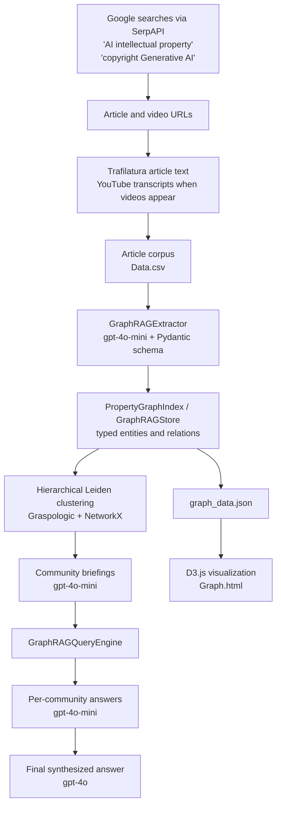

# GraphRAG on an AI Copyright Knowledge Graph

This project builds a GraphRAG pipeline over a small corpus of news and policy writing on AI copyright, intellectual property, and governance. It searches Google for relevant articles, scrapes their text, uses an LLM to extract a typed set of entities and relationships, clusters the resulting graph, writes a briefing for each cluster, and answers questions by synthesizing those briefings. An interactive D3.js visualization is included so the graph can be inspected directly.

## Problem and motivation

Questions in this domain are rarely answered by a single passage. They cut across lawsuits, agencies, statutes, and company positions that appear in different documents — for example, how U.S., EU, and U.K. approaches compare, or which organizations show up as plaintiffs or defendants. Chunk-similarity RAG can miss those connections because it retrieves isolated passages rather than a structured view of the entities involved.

This pipeline takes a Microsoft GraphRAG-style approach: extract a knowledge graph with a fixed ontology, detect communities of related entities, summarize each community, and answer questions from those summaries instead of from raw vector search. Vector embeddings are intentionally turned off (`embed_kg_nodes=False`); retrieval is entirely graph- and summary-based.

## Architecture



## Tech stack

Only libraries the notebooks actually import are listed here.

| Layer | Libraries |
|---|---|
| Search and scraping | SerpAPI (`google-search-results`), Trafilatura, YouTube Transcript API, pandas |
| Graph construction | LlamaIndex `PropertyGraphIndex` and `SimplePropertyGraphStore`, a custom `GraphRAGExtractor`, Pydantic structured output |
| Community detection | NetworkX, Graspologic `hierarchical_leiden` |
| LLMs | OpenAI via `llama-index-llms-openai`: `gpt-4o-mini` for extraction, community summaries, and per-community answers; `gpt-4o` for final synthesis |
| Visualization | D3.js v7 (CDN) driven by exported JSON |
| Runtime | Jupyter, `nest_asyncio`, `python-dotenv` |

There is no embedding model and no vector store in this repo.

## Repository structure

```
.
├── scrape_Data.ipynb          # SerpAPI search + article/video text collection
├── Code.ipynb                 # Ontology, extraction, graph, communities, queries, viz export
├── Data.csv                   # 13 successfully scraped articles (committed corpus)
├── graph_data.json            # Exported graph: 117 nodes, 137 edges, 28 communities
├── Graph.html                 # Interactive D3 visualization with the exported graph baked in
├── graph_temp.html            # D3 HTML template (placeholder for graph JSON)
├── Images of Knowledge Graph/ # Screenshots of the visualization
│   ├── 1.jpeg
│   ├── 2.jpeg
│   ├── 3.jpeg
│   └── 4.jpeg
└── .gitignore
```

A few filenames in the notebooks differ from the files committed here:

| Notebook expects | In this repo |
|---|---|
| `ai_copyright_dataset.csv` | `Data.csv` |
| `graph_template.html` | `graph_temp.html` |
| `ai_copyright_graph.html` | `Graph.html` (prebuilt; already contains the graph data) |

Copy or rename those files before re-running the notebooks, or change the paths in the cells.

## How it works

### 1. Collect the corpus (`scrape_Data.ipynb`)

The scraper calls SerpAPI's Google engine for two queries — `"AI intellectual property"` and `"copyright Generative AI"` — with `hl=en` and `gl=us`. It keeps up to 10 organic results per query (title, snippet, source, date, URL) and also records any inline videos. Duplicate URLs are dropped.

Article pages are fetched concurrently with Trafilatura (5 workers, 1 second delay per request). If a result is a YouTube video, the notebook tries to pull an English transcript. Rows that fail to download or extract are discarded.

In the saved run, 10 articles were collected for each query, 18 unique URLs were scraped, and **13 articles succeeded**. Five sources failed to download (Forbes, Dentons, American Bar Association, Congress.gov, and RAND). No videos are present in the committed `Data.csv`.

Each row has these columns: `query`, `title`, `snippet`, `source`, `date`, `url`, `type`, `full_text`, `video_id`, `status`. Sources in the committed file include the U.S. Copyright Office, WIPO, Nixon Peabody, Yale Law Journal, the Association of Research Libraries, and others, with article dates ranging from January 2024 to September 2025.

### 2. Define an ontology and extract the graph (`Code.ipynb`)

Each article's `full_text` is wrapped as a single LlamaIndex `Document` (title, source, and date stored as metadata). The notebook does not chunk documents.

Extraction is constrained to a fixed vocabulary:

**Entity types:** `ORGANIZATION`, `PERSON`, `LEGISLATION`, `LEGAL_CASE`, `CONCEPT`, `GOVERNMENT`, `AI_SYSTEM`

**Relationship types:** `FILED_AGAINST`, `DEFENDANT_IN`, `REGULATES`, `ADVOCATES_FOR`, `TRAINED_ON`, `PART_OF`, `REFERENCES`, `OPPOSES`

`GraphRAGExtractor` sends each document to `gpt-4o-mini` (`temperature=0`) with that ontology in the prompt and parses the response through Pydantic models (`ExtractedEntity`, `ExtractedRelationship`, `ExtractionResult`) using OpenAI function calling. Every entity and relation is stored with a short description, not just a label. Up to 20 triplets are requested per document, and four documents are processed in parallel. If a relationship endpoint was not also returned as an entity, the extractor falls back to a generic `ENTITY` label.

LlamaIndex `PropertyGraphIndex` writes the results into `GraphRAGStore`, a thin subclass of `SimplePropertyGraphStore`.

The committed `graph_data.json` contains **117 nodes** and **137 edges**:

| Entity type | Count | Relationship type | Count |
|---|---:|---|---:|
| ORGANIZATION | 31 | REFERENCES | 35 |
| LEGISLATION | 22 | REGULATES | 31 |
| CONCEPT | 19 | ADVOCATES_FOR | 23 |
| PERSON | 18 | PART_OF | 17 |
| GOVERNMENT | 9 | OPPOSES | 16 |
| AI_SYSTEM | 8 | FILED_AGAINST | 10 |
| LEGAL_CASE | 8 | TRAINED_ON | 4 |
| ENTITY (fallback) | 2 | DEFENDANT_IN | 1 |

The most connected nodes are `U.S. COPYRIGHT OFFICE`, `AI`, `COPYRIGHT`, `GENERATIVE AI`, and `COPYRIGHT LAW`. Eleven nodes have no edges.

### 3. Cluster, summarize, and query

`GraphRAGStore.build_communities()` converts the property graph to an undirected NetworkX graph and runs Graspologic's hierarchical Leiden algorithm (`max_cluster_size=10`). For each cluster it gathers member entities, their descriptions, and intra-community relations, then asks `gpt-4o-mini` to write a 3–5 sentence briefing. The exported graph records **28 communities**.

`GraphRAGQueryEngine` does not use embeddings or similarity search. For a user question it:

1. Asks `gpt-4o-mini` to answer from each community briefing independently. Briefings the model judges irrelevant (`"No relevant information."`) are dropped.
2. Sends the remaining partial answers to `gpt-4o` (`temperature=0`) to produce one de-duplicated final response.

### 4. Visualize

`export_graph_data()` writes `graph_data.json`. `visualize_graph()` injects that JSON into an HTML template and saves a standalone page. `Graph.html` is a prebuilt copy of that visualization: a force-directed D3 graph with color-coded entity types, node size scaled by degree, hover tooltips, click-to-highlight neighborhoods, sliders for link distance, repulsion, node size, and label density, plus zoom reset. Open `Graph.html` in a browser — no notebook run is required to explore the existing graph.

## Screenshots

Overview of the full graph, including smaller disconnected clusters around a dense central component:


Zoomed view of the main cluster. Highly connected nodes such as the U.S. Copyright Office, copyright, and generative AI sit at the center:


Neighborhood highlight around the `COPYRIGHT` node, with incident edges emphasized:


The same layout with edges hidden, which makes entity clusters easier to read:


## Getting started

You need Python 3.10+, Jupyter, an [OpenAI](https://platform.openai.com/) API key, and — only if you want to re-scrape — a [SerpAPI](https://serpapi.com/) key.

```bash
git clone https://github.com/vishnu322010326030/GraphRAG-System-on-CopyRight-Knowledge-Graph.git
cd GraphRAG-System-on-CopyRight-Knowledge-Graph

python -m venv .venv
source .venv/bin/activate  # Windows: .venv\Scripts\activate

pip install llama-index llama-index-llms-openai graspologic pandas nest-asyncio python-dotenv networkx pydantic
# Only needed to re-run the scraper:
pip install google-search-results trafilatura youtube_transcript_api
```

Create a `.env` file in the repo root (the file is gitignored):

```bash
OPENAI_API_KEY=your-openai-key
SERPAPI_KEY=your-serpapi-key
```

The notebooks load these with `python-dotenv`. Do not hardcode keys in cells.

To explore the graph that is already in the repo, open `Graph.html` in a browser.

To rebuild the graph or run queries:

1. Point `Code.ipynb` at the committed corpus, either by copying `Data.csv` to `ai_copyright_dataset.csv` or by changing the `read_csv` path.
2. If you want to regenerate the HTML from the notebook, copy `graph_temp.html` to `graph_template.html` (the name the visualization cell looks for), or pass the existing filename into `visualize_graph()`.
3. Open `Code.ipynb` in Jupyter and run the cells in order. Extraction and community summarization call the OpenAI API and will take several minutes.
4. Optionally re-run `scrape_Data.ipynb` first to collect a fresh dataset; it writes `ai_copyright_dataset.csv`.

## Example queries

These are the questions exercised in `Code.ipynb`. The notebook does not include saved model answers.

- *What are the main legal arguments being made around AI copyright and training data?*
- *Which companies are involved in AI copyright or governance disputes, and what are their positions?*
- *How are different governments (e.g. EU, US, and UK) approaching AI governance?*
- *What is the role of fair use in AI copyright disputes?*

## Limitations and future work

- The committed corpus is small: 13 articles, and five of the original search hits never scraped. Findings reflect this slice of sources, not a comprehensive legal survey.
- There is no entity resolution. The same real-world actor can appear under multiple nodes (for example `U.S. COPYRIGHT OFFICE`, `US COPYRIGHT OFFICE`, and `COPYRIGHT OFFICE`). Two relationship endpoints were also stored with the fallback type `ENTITY` and no description.
- Documents are not chunked. Most articles are short enough for that to be reasonable, but the Wikipedia page in this dataset is over 120,000 characters.
- Query-time cost scales with the number of communities, because every briefing is sent to the model. With 28 communities that is a noticeable number of LLM calls per question.
- The graph store is not persisted separately from a notebook session; re-running extraction is required unless you start from the saved `graph_data.json` for visualization only.

Natural next steps are canonicalizing duplicate entities, chunking long documents, and saving the property graph so extraction does not have to be repeated.

## Author

**Vishnu Swarup Pujari**

- [LinkedIn](https://www.linkedin.com/in/vishnu-swarup-pujari-ab76661b9/)
- [GitHub](https://github.com/vishnu322010326030)
